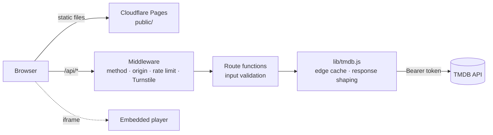

<div align="center">

# flix<sup>●</sup>

**Find a movie or series, pick an episode, press play.**

A fast, minimal web app for browsing movies and TV, built on TMDB data and running entirely on Cloudflare Pages.

[**Live demo → flix.awad.lol**](https://flix.awad.lol) &nbsp;·&nbsp; [Architecture](flix.md)

[](https://github.com/0xawad/flix/actions/workflows/ci.yml)


</div>

---

## Features

| | |
|---|---|
| 🎬 **Cinematic home** | A featured hero, then Continue watching, Trending, Popular movies and Popular series rows |
| 🔎 **Search** | Searches TMDB's whole catalog of movies and series. Press `/` from anywhere, and use **Load more** for long result lists |
| 📄 **Title pages** | Backdrop, rating, genres, runtime or season count, and an episode list with thumbnails and air dates |
| ▶️ **Theater player** | A 16:9 player, server switcher, and **Next episode** (`N`) that carries on into the next season and skips unaired episodes |
| ⏯ **Continue watching** | Remembers the last movie or episode per title, on this device only. Nothing is sent to a server |
| 🔗 **Shareable URLs** | Every screen has its own link, down to a single episode. Back and forward work, and keep your scroll position |
| 📱 **Responsive** | Built for phones first, from 320px wide up to ultrawide screens. Supports `prefers-reduced-motion` |
| 🛡 **Hardened API** | Edge-cached TMDB proxy with rate limiting, input checks, strict CSP, and optional Cloudflare Turnstile |

## How it works



- **No framework, no build step.** The client is plain HTML, CSS and one JavaScript file. The server is Pages Functions.
- **The TMDB key stays on the server.** The browser only calls `/api/*`, which proxies TMDB, keeps only the fields the UI needs (payloads are about 1–3 KB), and caches the result at the edge for between 10 minutes and 6 hours.
- **The URL is the state.** Each view (`#/`, `#/search/…`, `#/tv/1399/season/2`, `#/tv/1399/watch/2/4`) is rendered from the hash.

See [`flix.md`](flix.md) for details on the routes, middleware, caching and client.

## Quick start

**Requirements:** Node 20+ and a free [TMDB API Read Access Token](https://www.themoviedb.org/settings/api).

```bash
git clone https://github.com/0xawad/flix
cd flix
echo "TMDB_API_KEY=<your-tmdb-read-access-token>" > .dev.vars
npm run dev            # wrangler pages dev on http://localhost:8788
```

`.dev.vars` is git-ignored. To try the Turnstile flow locally, add Cloudflare's [test keys](https://developers.cloudflare.com/turnstile/troubleshooting/testing/):

```bash
TURNSTILE_SITE_KEY=1x00000000000000000000AA
TURNSTILE_SECRET_KEY=1x0000000000000000000000000000000AA
```

### Scripts

| Command | What it does |
|---|---|
| `npm run dev` | Runs the site and API locally with Wrangler (fetched via `npx`) |
| `npm test` | Runs the API and middleware tests (`node:test`, no dependencies) |
| `npm run check` | Syntax-checks the client, checks asset versions, and runs the tests. This is what CI runs |
| `npm run version-assets` | Updates the `?v=` hashes in `index.html`. **Run it after editing CSS or JS** |

## Deploy your own

1. Fork this repo.
2. In Cloudflare, go to **Workers & Pages → Create → Pages → Connect to Git** and select your fork.
   - Build command: *(leave empty)*
   - Build output directory: `public`
3. Under **Settings → Variables and Secrets**, add `TMDB_API_KEY` as an encrypted secret.
4. Deploy. Pushes to `main` go to production, and other branches get preview URLs.

### Configuration

| Variable | Required | Description |
|---|:---:|---|
| `TMDB_API_KEY` | ✅ | TMDB **Read Access Token** (v4, sent as a Bearer header). A legacy v3 API key also works |
| `TURNSTILE_SITE_KEY` | — | Turnstile site key. Set it together with the secret to require a human check |
| `TURNSTILE_SECRET_KEY` | — | Turnstile secret key (encrypt it) |
| `SESSION_SECRET` | — | Signs session cookies. If unset, it's derived from the Turnstile secret |
| `RATE_LIMITER` | — | Optional Workers Rate Limiting binding. Otherwise a per-isolate limiter is used |

### Optional: bot protection with Turnstile

1. In Cloudflare, go to **Turnstile → Add widget**. Set the hostname to your domain and the mode to **Managed**.
2. Add `TURNSTILE_SITE_KEY` and `TURNSTILE_SECRET_KEY` to the Pages project, then redeploy.

A visitor's first API call then runs a short check, which is usually invisible. Passing it sets a signed, HttpOnly session cookie that lasts 12 hours. Requests without that cookie get `401`, so scripts can't use up your TMDB quota.

For a hard limit on top of that, add a WAF **rate-limiting rule** for `/api/` (the free plan includes one).

## API

All endpoints accept `GET` only and return trimmed JSON.

| Endpoint | Returns | Edge cache |
|---|---|---|
| `/api/trending?type=all\|movie\|tv` | Trending this week | 1 h |
| `/api/search?q=…&page=…` | Movies and series matching `q` (max 100 characters) | 10 min |
| `/api/movie/:id` | Movie details | 6 h |
| `/api/tv/:id` | Series details and season list | 6 h |
| `/api/tv/:id/season/:n` | Episodes with thumbnails | 6 h |
| `POST /api/session` | Exchanges a Turnstile token for a session cookie | — |

Errors are always JSON: `400` invalid input · `401` needs verification · `403` cross-site · `404` not found · `405` method · `429` rate limited · `502/503` TMDB failure.

## Project structure

```
public/                 static site (served as-is)
  index.html            markup and icon sprite
  css/style.css         design system and all views
  js/app.js             router, views, player, Continue watching
  _headers              CSP and security headers
functions/api/          Pages Functions, one file per route
  _middleware.js        runs before every /api/* request
lib/                    shared server code (TMDB client, sessions)
test/                   node:test suites
scripts/                asset versioning
```

## Contributing

Issues and pull requests are welcome. Before you open a PR:

```bash
npm run version-assets   # if you changed public/css or public/js
npm run check            # must pass, same as CI
```

Keep it dependency-free and build-free. The whole app should stay understandable in an afternoon.

## Disclaimer

Flix doesn't host, upload or store any video. Metadata and images come from [TMDB](https://www.themoviedb.org/). Playback is provided by independent third-party embed services that this project doesn't control or endorse. You're responsible for making sure your use complies with the laws in your country and with those services' terms.

<sub>This product uses the TMDB API but is not endorsed or certified by TMDB.</sub>
